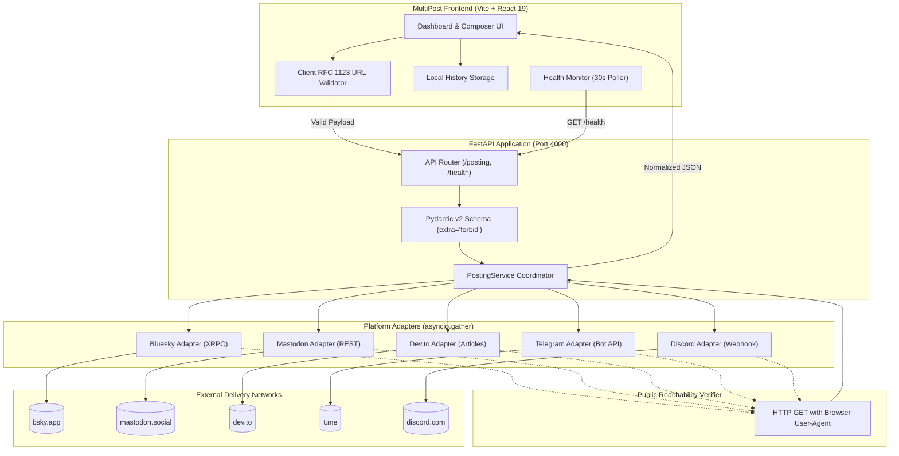

# MultiPost — Automated Multi-Platform Posting System

<p align="center">
  <strong>One message. Five platforms. Zero repetitive work.</strong>
</p>

<p align="center">
  
  
  
  
  
  
  
</p>

---

## 📖 Table of Contents

1. [Executive Summary & Problem Statement](#executive-summary--problem-statement)
2. [End-to-End System Architecture](#end-to-end-system-architecture)
3. [System Architecture Diagram](#system-architecture-diagram)
4. [Platform Adapters & Protocol Specifications](#platform-adapters--protocol-specifications)
5. [Repository Structure](#repository-structure)
6. [Prerequisites & Installation](#prerequisites--installation)
   - [1. Backend Setup (Port 4000)](#1-backend-setup-port-4000)
   - [2. Frontend Setup (Port 5174)](#2-frontend-setup-port-5174)
7. [Environment Variables & Configuration](#environment-variables--configuration)
8. [Platform Credentials Guide](#platform-credentials-guide)
9. [API Reference & Sample Payloads](#api-reference--sample-payloads)
10. [Automated Testing Suite (86 Pytest Cases)](#automated-testing-suite-86-pytest-cases)
11. [Security, Masking & Fault Isolation](#security-masking--fault-isolation)
12. [Platform Caveats & Architectural Nuances](#platform-caveats--architectural-nuances)

---

## 🎯 Executive Summary & Problem Statement

Modern content creators, developer advocates, and marketing teams face an increasingly fragmented social ecosystem. Distributing a single product launch or technical update across microblogging networks, decentralized fediverse instances, developer blogs, and messaging communities requires tedious manual formatting, tab switching, and link pasting.

**MultiPost** solves this with a unified, enterprise-grade publishing engine:
- **Single Dispatch**: Broadcast announcements simultaneously across **Bluesky**, **Mastodon**, **Dev.to**, **Telegram**, and **Discord**.
- **Concurrent Non-Blocking Execution**: Orchestrated with asynchronous HTTP connection pools over `asyncio.gather()`.
- **Fault-Isolated Architecture**: A rate limit, authentication error, or downtime on one platform never impacts or delays the remaining platforms.
- **Independent Verification**: Evaluates public reachability with automated HTTP GET verification checks without altering publication status.
- **Premium SaaS Dashboard**: React 19 + Tailwind CSS frontend featuring dark mode aesthetics, live health monitoring, client-side RFC URL validation, and local session history.

---

## 🏗️ End-to-End System Architecture

```
┌────────────────────────────────────────────────────────────────────────┐
│                        MultiPost Web Dashboard                         │
│             (React 19 + Vite + Tailwind CSS • Port 5174)               │
│   - Target Platform Readiness      - Real-time RFC 1123 URL Validator   │
│   - Live Character Counter (<=200) - Fault-Tolerant Results Summary    │
│   - Local History Inspector        - Settings & Diagnostic Controls    │
└───────────────────────────────────┬────────────────────────────────────┘
                                    │ HTTP / CORS (Port 4000)
                                    ▼
┌────────────────────────────────────────────────────────────────────────┐
│                        FastAPI API Orchestrator                        │
│             (Pydantic v2 + HTTPX + Uvicorn • Port 4000)                │
│   - GET /health: Dynamic platform readiness probe                      │
│   - POST /posting: Strict input validation & parallel orchestrator     │
└───────────────────┬────────────────────────────────┬───────────────────┘
                    │                                │
                    ▼                                ▼
       ┌────────────────────────┐       ┌────────────────────────┐
       │   Pydantic Validation  │       │ PostingService Gateway │
       │ - Max 200 Characters   │       │ - asyncio.gather()     │
       │ - Exactly 1 valid URL  │       │ - Connection pooling   │
       │ - Forbid client routing│       │ - Exception isolation  │
       └────────────────────────┘       └────────────┬───────────┘
                                                     │
         ┌───────────────────┬───────────────────┼───────────────────┬───────────────────┐
         ▼                   ▼                   ▼                   ▼                   ▼
   ┌───────────┐       ┌───────────┐       ┌───────────┐       ┌───────────┐       ┌───────────┐
   │  Bluesky  │       │ Mastodon  │       │  Dev.to   │       │ Telegram  │       │  Discord  │
   │AT Protocol│       │ActivityPub│       │ Forem API │       │  Bot API  │       │  Webhook  │
   │   XRPC    │       │   REST    │       │  Article  │       │sendMessage│       │?wait=true │
   └─────┬─────┘       └─────┬─────┘       └─────┬─────┘       └─────┬─────┘       └─────┬─────┘
         │                   │                   │                   │                   │
         └───────────────────┼───────────────────┼───────────────────┼───────────────────┘
                             │ Parallel Verification HTTP GETs
                             ▼
               ┌───────────────────────────┐
               │  Public URL Verification  │
               │  - True: 200 OK (Public)  │
               │  - False: 401/403/Login   │
               │  - None: Gated / Timeout  │
               └─────────────┬─────────────┘
                             │
                             ▼
               ┌───────────────────────────┐
               │ Result Sanitizer & Output │
               │ - Mask bot/bearer secrets │
               │ - Compute success rate    │
               │ - Unified JSON response   │
               └───────────────────────────┘
```

---

## 📊 System Architecture Diagram



---

## 🔌 Platform Adapters & Protocol Specifications

| Platform | Protocol / API | Endpoint | Public URL Pattern | Visibility Behavior |
|---|---|---|---|---|
| **Bluesky** | AT Protocol XRPC | `com.atproto.repo.createRecord` | `https://bsky.app/profile/{handle}/post/{rkey}` | `public_access: true` (Public unauthenticated web portal) |
| **Mastodon** | Fediverse REST API | `POST /api/v1/statuses` | `https://{instance}/@{user}/{status_id}` | `public_access: true` (Public status federated) |
| **Dev.to** | Forem Articles API | `POST /api/articles` | `https://dev.to/{username}/{slug}` | `public_access: true` (Public blog article) |
| **Telegram** | Telegram Bot API | `POST /bot{token}/sendMessage` | `https://t.me/{channel_username}/{message_id}` | `public_access: true` if public `@channel`; `null` if private |
| **Discord** | Webhooks (`?wait=true`) | `POST /api/webhooks/{id}/{token}` | `https://discord.com/channels/{guild}/{channel}/{msg}` | `public_access: false` (Authentication-gated guild) |

---

## 📁 Repository Structure

```
multi-post/
├── app/
│   ├── __init__.py               # Package marker
│   ├── main.py                   # FastAPI app, CORS middleware, /posting, /health
│   ├── schemas.py                # Pydantic v2 schemas & RFC 1123 URL validator
│   ├── config.py                 # Pydantic Settings loaded from .env
│   ├── platforms/                # Platform adapters package
│   │   ├── __init__.py           # Adapter exports
│   │   ├── base.py               # Abstract BasePlatformAdapter, timeout & sanitization
│   │   ├── bluesky.py            # Bluesky XRPC session & record adapter
│   │   ├── mastodon.py           # Mastodon ActivityPub status adapter
│   │   ├── devto.py              # Dev.to Forem article adapter
│   │   ├── telegram.py           # Telegram Bot API message adapter
│   │   └── discord.py            # Discord Webhook adapter
│   └── services/
│       ├── __init__.py           # Services package marker
│       └── posting_service.py    # Multi-platform async orchestrator using asyncio.gather
├── frontend/
│   ├── .env                      # Frontend environment (VITE_API_BASE_URL)
│   ├── .env.example              # Environment template
│   ├── package.json              # React 19, Vite, Tailwind CSS, Lucide React
│   ├── vite.config.js            # Port 5174 host configuration
│   ├── tailwind.config.js        # Design tokens & color system
│   ├── index.html                # App entry point
│   ├── README.md                 # Frontend-specific architecture documentation
│   └── src/
│       ├── main.jsx              # React DOM bootstrap
│       ├── App.jsx               # Application shell & route coordinator
│       ├── index.css             # Inter typography & design tokens
│       ├── services/
│       │   └── api.js            # Fetch API client for /health and /posting
│       ├── utils/
│       │   ├── platforms.js      # Platform metadata & protocols
│       │   ├── storage.js        # LocalStorage history manager
│       │   └── urlValidator.js   # Client-side RFC URL validator
│       ├── components/
│       │   ├── Header.jsx        # Top navigation, status indicator & date
│       │   ├── Sidebar.jsx       # Brand sidebar & navigation links
│       │   ├── PlatformCard.jsx  # Individual platform status card
│       │   ├── PlatformIcon.jsx  # SVG platform brand icons
│       │   ├── PostComposer.jsx  # Composer textarea, live validator, submit button
│       │   ├── PlatformResult.jsx# Per-platform result card with external link
│       │   └── ResultsSummary.jsx# Dynamic stat cards & results grid
│       └── pages/
│           ├── Dashboard.jsx     # Main dashboard view
│           ├── Compose.jsx       # Dedicated composition view
│           ├── History.jsx       # Browser local history view & modal
│           ├── Integrations.jsx  # Platform integration specs view
│           └── Settings.jsx      # API endpoint configuration view
├── tests/
│   ├── __init__.py               # Test package marker
│   ├── test_posting.py           # End-to-end API integration tests
│   ├── test_validation.py        # URL parsing & schema boundary tests
│   └── test_platforms.py         # Unit tests for platform adapters & sanitization
├── .env.example                  # Backend template environment file
├── .gitignore                    # Git tracking rules
├── pytest.ini                    # Pytest configuration
├── requirements.txt              # Pinned Python dependencies
└── README.md                     # Master documentation
```

---

## 🚀 Prerequisites & Installation

### System Requirements
- **Python**: 3.10, 3.11, or 3.12
- **Node.js**: v18.0.0 or higher
- **npm**: v9.0.0 or higher

---

### 1. Backend Setup (Port 4000)

```bash
# 1. Clone the repository
git clone https://github.com/viditsharma1405/multi-post.git
cd multi-post

# 2. Create and activate a Python virtual environment
python3 -m venv .venv
source .venv/bin/activate

# 3. Install production & testing dependencies
pip install --upgrade pip
pip install -r requirements.txt

# 4. Copy backend environment template
cp .env.example .env
# Edit .env with your platform credentials (see Platform Credentials Guide)

# 5. Start the FastAPI server on port 4000
uvicorn app.main:app --host 0.0.0.0 --port 4000 --reload
```

*Verify Backend Health:*
```bash
curl http://localhost:4000/health
# Expected: {"status":"ok","platforms_configured":{...},"version":"1.0.0"}
```

---

### 2. Frontend Setup (Port 5174)

In a new terminal window:
```bash
cd multi-post/frontend

# 1. Install dependencies
npm install

# 2. Copy frontend environment template
cp .env.example .env

# 3. Start Vite development server
npm run dev
```

Open your browser to:
👉 **`http://localhost:5174`**

*(Note: Port 5174 is configured in `vite.config.js` to avoid port collisions.)*

---

## ⚙️ Environment Variables & Configuration

### Backend (`.env`)
```env
# Bluesky
BLUESKY_HANDLE=yourname.bsky.social
BLUESKY_APP_PASSWORD=xxxx-xxxx-xxxx-xxxx

# Mastodon
MASTODON_INSTANCE_URL=https://mastodon.social
MASTODON_ACCESS_TOKEN=your_oauth_access_token

# Dev.to
DEVTO_API_KEY=your_devto_api_key
DEVTO_ARTICLE_TITLE=Automated Platform Update

# Telegram
TELEGRAM_BOT_TOKEN=123456789:ABCdefGhIJKlmNoPQRstuVWXyz
TELEGRAM_CHAT_ID=-1001234567890
TELEGRAM_CHANNEL_USERNAME=my_public_channel

# Discord
DISCORD_WEBHOOK_URL=https://discord.com/api/webhooks/123/abc
DISCORD_GUILD_ID=123456789012345678

# Timeouts (Seconds)
REQUEST_TIMEOUT_SECONDS=10.0
VERIFICATION_TIMEOUT_SECONDS=5.0
```

### Frontend (`frontend/.env`)
```env
VITE_API_BASE_URL=http://localhost:4000
```

> **Security Rule**: Platform credentials must **never** be placed in frontend environment files. The frontend only stores the orchestrator URL.

---

## 🔑 Platform Credentials Guide

### 1. Bluesky
1. Log in to [bsky.app](https://bsky.app).
2. Go to **Settings** → **Privacy and Security** → **App Passwords**.
3. Create an App Password named `multipost` and copy the generated password.
4. Set `BLUESKY_HANDLE` and `BLUESKY_APP_PASSWORD`.

### 2. Mastodon
1. Log in to your Mastodon instance (e.g., `https://mastodon.social`).
2. Navigate to **Preferences** → **Development** → **New Application**.
3. Enable the `write:statuses` scope and submit.
4. Copy the generated **Access Token** into `MASTODON_ACCESS_TOKEN`.

### 3. Dev.to
1. Log in to [dev.to](https://dev.to).
2. Go to **Settings** → **Extensions**.
3. Generate a new API key under **DEV Community API Keys**.
4. Copy key into `DEVTO_API_KEY`.

### 4. Telegram
1. Message [@BotFather](https://t.me/BotFather) on Telegram and send `/newbot` to receive your `TELEGRAM_BOT_TOKEN`.
2. Add the bot to your target channel as an **Administrator** with posting permissions.
3. For public channels, set `TELEGRAM_CHAT_ID=@channel_handle` and `TELEGRAM_CHANNEL_USERNAME=channel_handle`.

### 5. Discord
1. In Discord, navigate to **Server Settings** → **Integrations** → **Webhooks**.
2. Click **New Webhook**, select the desired channel, and copy the Webhook URL.
3. Enable Developer Mode, right-click the server icon, click **Copy Server ID**, and set `DISCORD_GUILD_ID`.

---

## 📡 API Reference & Sample Payloads

### 1. Health Probe (`GET /health`)
```bash
curl -X GET http://localhost:4000/health
```
```json
{
  "status": "ok",
  "platforms_configured": {
    "bluesky": true,
    "mastodon": true,
    "devto": true,
    "telegram": true,
    "discord": true
  },
  "version": "1.0.0"
}
```

### 2. Publish Broadcast (`POST /posting`)
```bash
curl -X POST http://localhost:4000/posting \
  -H "Content-Type: application/json" \
  -d '{
    "message": "Excited to launch our platform update! Learn more at https://example.com"
  }'
```

```json
{
  "success": true,
  "summary": {
    "total": 5,
    "successful": 4,
    "failed": 1
  },
  "results": [
    {
      "platform": "bluesky",
      "status": "success",
      "posted_url": "https://bsky.app/profile/user.bsky.social/post/3n2drxrbmtq27",
      "public_access": true,
      "date": "2026-11-15",
      "time": "10:14:00",
      "error": null
    },
    {
      "platform": "mastodon",
      "status": "success",
      "posted_url": "https://mastodon.social/@user/1122334455",
      "public_access": true,
      "date": "2026-11-15",
      "time": "10:14:01",
      "error": null
    },
    {
      "platform": "devto",
      "status": "success",
      "posted_url": "https://dev.to/user/automated-platform-update-1234",
      "public_access": true,
      "date": "2026-11-15",
      "time": "10:14:02",
      "error": null
    },
    {
      "platform": "telegram",
      "status": "success",
      "posted_url": "https://t.me/mychannel/42",
      "public_access": true,
      "date": "2026-11-15",
      "time": "10:14:02",
      "error": null
    },
    {
      "platform": "discord",
      "status": "failed",
      "posted_url": null,
      "public_access": null,
      "date": null,
      "time": null,
      "error": "Discord API returned HTTP 404: Unknown Webhook"
    }
  ]
}
```

---

## 🧪 Automated Testing Suite (86 Pytest Cases)

All tests execute offline using `pytest-asyncio` and `respx` to mock external API endpoints without requiring live credentials:

```bash
# Run complete test suite
pytest -v

# Output:
# tests/test_platforms.py ......................... [ 39%]
# tests/test_posting.py ........................... [ 47%]
# tests/test_validation.py ........................ [100%]
# ============================== 86 passed in 3.07s ==============================
```

---

## 🛡️ Security, Masking & Fault Isolation

1. **Automatic Secret Masking**:
   - `BasePlatformAdapter.sanitize_error` filters Telegram bot tokens (`bot***`), Discord webhook secrets, Bearer tokens, and exact credential matches from all exception traces and JSON error fields.
2. **Zero Blind Retries**:
   - Creating posts/articles is non-idempotent. Non-idempotent operations are never retried blindly to prevent duplicate posts and rapid rate-limit exhaustion.
3. **No Client Platform Tampering**:
   - Pydantic's `extra="forbid"` rejects attempts by clients to pass target platform lists. Platform selection is strictly server-side.
4. **Git Safety**:
   - `.gitignore` strictly protects `.env`, virtual environments, and credential files from source control commits.

---

## 📝 Platform Caveats & Architectural Nuances

- **Bluesky Client Timestamps**: AT Protocol `app.bsky.feed.post` requires `createdAt` to be supplied by the client during record creation. MultiPost reports this metadata only upon receiving verified `uri` confirmation from the XRPC server.
- **Dev.to Article Dates**: The adapter strictly evaluates `published_at` and does not use `created_at` as a fallback.
- **Telegram Public Web URLs**: URLs are only constructed when the channel is public with a configured `@username`. Private channels return `posted_url: null` and `public_access: null`.
- **Discord Authentication Gating**: Discord channels require user authentication. Public GET verification correctly evaluates `public_access: false`.
- **Verification Non-Demotion**: Verification checks never demote or alter a successful publication (`status: "success"`).

---

## 📄 License

This project is licensed under the MIT License — see the [LICENSE](LICENSE) file for details.
