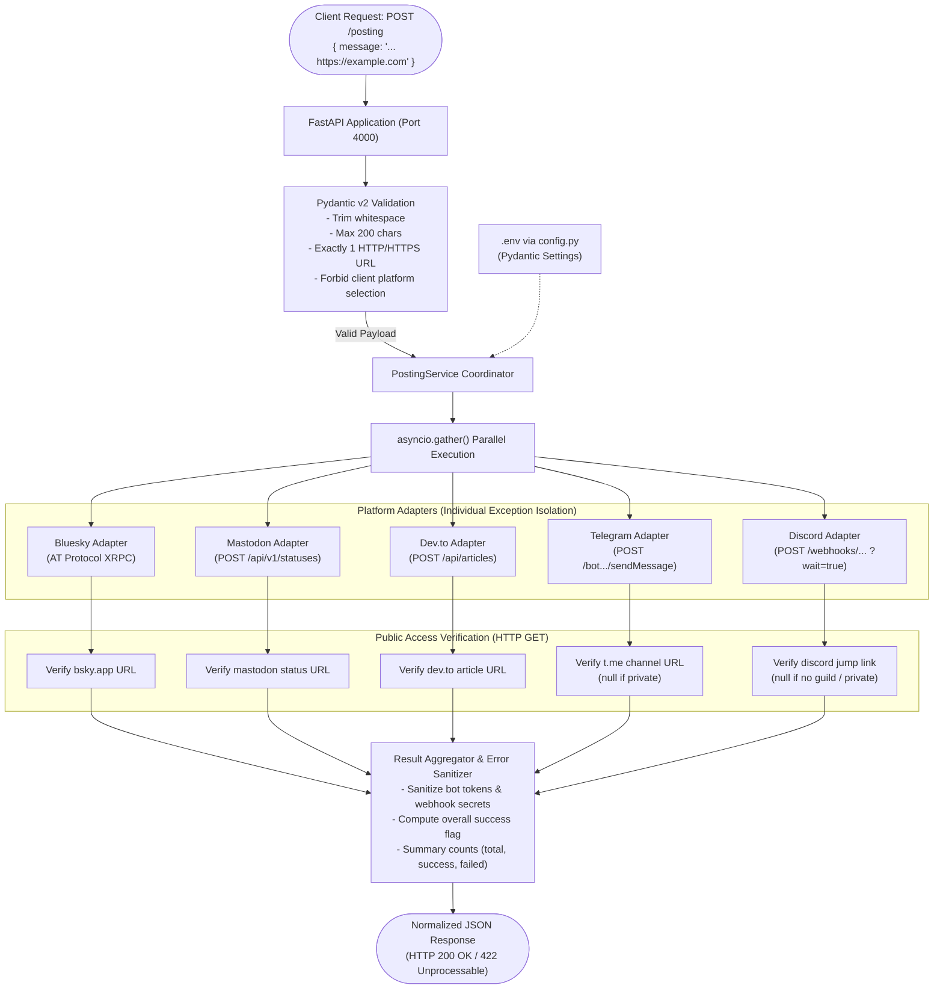

# Automated Multi-Platform Posting System

A high-performance, asynchronous Python REST API built with **FastAPI**, **Pydantic v2**, and **HTTPX** that automatically distributes marketing and announcement posts across five social and publishing platforms: **Bluesky**, **Mastodon**, **Dev.to**, **Telegram**, and **Discord**.

Platform selection is strictly internal; client requests submit a single message containing an embedded link, and the system concurrently broadcasts the update, verifies public accessibility, isolates platform-level failures, and returns a normalized JSON response.

---

## Table of Contents

1. [Project Overview and Objective](#project-overview-and-objective)
2. [Key Features](#key-features)
3. [Architecture and Request Lifecycle](#architecture-and-request-lifecycle)
4. [Mermaid Architecture Diagram](#mermaid-architecture-diagram)
5. [Project Folder Structure](#project-folder-structure)
6. [Prerequisites and Installation](#prerequisites-and-installation)
7. [Environment Variables and Configuration](#environment-variables-and-configuration)
8. [Platform Credentials Guide with Official Documentation](#platform-credentials-guide-with-official-documentation)
9. [Starting the Application](#starting-the-application)
10. [Swagger UI Interactive Documentation](#swagger-ui-interactive-documentation)
11. [Sample curl Requests and Responses](#sample-curl-requests-and-responses)
12. [Running the Automated Test Suite](#running-the-automated-test-suite)
13. [Security and Credential Sanitization](#security-and-credential-sanitization)
14. [Platform Caveats, Restrictions, and Architectural Notes](#platform-caveats-restrictions-and-architectural-notes)
15. [GitHub Submission Checklist](#github-submission-checklist)

---

## Project Overview and Objective

Organizations need to distribute visibility updates across diverse social media networks, developer communities, and chat applications. Manually posting to each network is slow and error-prone. 

This system provides a single, unified endpoint `POST /posting` running on port `4000`. The service:
- Accepts a message containing up to 200 characters and exactly one valid `http` or `https` URL.
- Simultaneously posts to **Bluesky**, **Mastodon**, **Dev.to**, **Telegram**, and **Discord** using official REST and XRPC endpoints.
- Verifies post accessibility using an asynchronous HTTP GET validation check.
- Guarantees full failure isolation: one platform's rate limit, downtime, or authentication error never impacts the execution of the other four platforms.
- Sanitizes all credentials and secret tokens from application logs and API error responses.

---

## Key Features

- **Strict Pydantic v2 Validation**: Dedicated URL regex extractor with punctuation stripping (e.g. trailing periods or parentheses in natural language), protocol enforcement (`http`/`https`), hostname verification, length bounds (`<= 200` chars), and rejection of extra payload fields (forbids client-side platform tampering).
- **Concurrent Non-Blocking Execution**: Orchestrated with Python's native `asyncio.gather()`, running external platform HTTP requests in parallel over shared `httpx.AsyncClient` connection pools.
- **Resilient Fault Isolation**: Individual try/except guards prevent single-point failures. If a platform is unconfigured or returns an HTTP error, it records a failure while sibling platforms proceed unhindered.
- **Public URL Verification**: Post-publication HTTP GET requests distinguish between successful submission and actual unauthenticated public availability. Verification failure does not demote publication success.
- **Zero Startup Crashes on Missing Secrets**: Platform credentials default to `None` with graceful per-platform error reporting if environment variables are not supplied.
- **Enterprise-Grade Sanitization**: Automatic masking of Telegram bot tokens, Discord webhook secrets, Bearer tokens, and sensitive keys from all logs and error messages.
- **Comprehensive Test Coverage**: 52 automated pytest test cases validating schemas, URL extraction edge cases, mocked platform adapters (`respx`), and full API integration flows.

---

## Architecture and Request Lifecycle

1. **Client Request**: A client submits an HTTP `POST` request to `http://localhost:4000/posting` with a JSON payload containing the `message` string.
2. **Schema & URL Validation**:
   - `PostingRequest` checks that `message` is non-empty after trimming and contains `<= 200` characters.
   - Extra fields (such as client-specified platform arrays) are rejected with HTTP 422 (`extra="forbid"`).
   - `extract_and_validate_single_url` strips surrounding prose punctuation, validates that exactly one URL exists, ensures scheme is `http` or `https`, and verifies valid hostname syntax.
3. **Posting Service Orchestration**:
   - The `PostingService` initializes adapters for all five platforms (`Bluesky`, `Mastodon`, `Dev.to`, `Telegram`, `Discord`), injecting environment settings from `config.py`.
4. **Concurrent Parallel Execution**:
   - Coroutines for all five platforms are scheduled simultaneously via `asyncio.gather(*tasks, return_exceptions=True)`.
5. **Platform Adapter Execution**:
   - Each adapter verifies its credentials. If credentials are missing, it returns a failed status with a clean configuration message.
   - For configured platforms, the adapter issues the official HTTP request with connection/read timeouts.
   - If the API succeeds, the adapter extracts the post identifier and constructs the platform URL.
6. **Public URL Verification**:
   - For platforms where a public URL was generated, an asynchronous HTTP GET request is performed with a browser User-Agent.
   - `public_access` is set to `True` (HTTP 200), `False` (HTTP 401/403/404 or timeout), or `None` (private platforms or ambiguous challenge).
7. **Aggregation & Normalization**:
   - `PostingService` consolidates results into a normalized `PostingResponse` containing an overall `success` boolean (`True` if at least one platform succeeded, `False` if all failed), summary counts, and an array of five `PlatformResult` items.

---

## Mermaid Architecture Diagram



---

## Project Folder Structure

```
automated-posting/
├── app/
│   ├── __init__.py               # Application package definition
│   ├── main.py                   # FastAPI app, endpoints (/posting, /health), error handling
│   ├── schemas.py                # Pydantic v2 schemas, URL extractor & validator
│   ├── config.py                 # Pydantic Settings loading from environment / .env
│   ├── platforms/                # Platform adapters package
│   │   ├── __init__.py           # Exports BasePlatformAdapter and all 5 adapters
│   │   ├── base.py               # Abstract base class, timeout, retry guard, sanitization
│   │   ├── bluesky.py            # AT Protocol XRPC adapter (createSession, createRecord)
│   │   ├── mastodon.py           # Mastodon REST API adapter (statuses)
│   │   ├── devto.py              # Dev.to Forem API adapter (articles)
│   │   ├── telegram.py           # Telegram Bot API adapter (sendMessage, t.me logic)
│   │   └── discord.py            # Discord Webhook adapter (?wait=true snowflake extraction)
│   └── services/
│       ├── __init__.py           # Services package definition
│       └── posting_service.py    # Multi-platform async orchestrator using asyncio.gather
├── tests/
│   ├── __init__.py               # Test package definition
│   ├── test_posting.py           # End-to-end API integration tests (health, 5 platforms)
│   ├── test_validation.py        # URL parsing, length checks, edge cases, 422 handling
│   └── test_platforms.py         # Unit tests for platform adapters, verification, masks
├── .env.example                  # Template configuration with placeholder credentials
├── .gitignore                    # Excludes virtual environments, .env, and caches
├── pytest.ini                    # Pytest configuration (asyncio mode, loop scope)
├── requirements.txt              # Pinned production and testing dependencies
└── README.md                     # Comprehensive architecture and operation guide
```

---

## Prerequisites and Installation

### Prerequisites
- **Python 3.10+** (Tested on Python 3.11)
- **pip** and **virtualenv**

### Installation Steps

1. Clone or navigate to the repository directory:
   ```bash
   cd multi-post
   ```

2. Create and activate a Python virtual environment:
   ```bash
   python3 -m venv .venv
   source .venv/bin/activate
   ```

3. Upgrade packaging tools and install required dependencies:
   ```bash
   pip install --upgrade pip setuptools wheel
   pip install -r requirements.txt
   ```

---

## Environment Variables and Configuration

Copy `.env.example` to `.env`:
```bash
cp .env.example .env
```

### Configuration Parameters

| Variable Name | Required | Default | Description |
|---|---|---|---|
| `BLUESKY_HANDLE` | Optional | `None` | Your Bluesky handle (e.g. `user.bsky.social`) |
| `BLUESKY_APP_PASSWORD` | Optional | `None` | App password generated from Bluesky Settings |
| `MASTODON_INSTANCE_URL` | Optional | `None` | Full URL of Mastodon instance (e.g. `https://mastodon.social`) |
| `MASTODON_ACCESS_TOKEN` | Optional | `None` | OAuth Bearer access token for Mastodon |
| `DEVTO_API_KEY` | Optional | `None` | API key from Dev.to Settings Extensions |
| `DEVTO_ARTICLE_TITLE` | Optional | `"Automated Platform Update"` | Title used when publishing articles to Dev.to |
| `TELEGRAM_BOT_TOKEN` | Optional | `None` | Bot token provided by @BotFather |
| `TELEGRAM_CHAT_ID` | Optional | `None` | Telegram channel ID (e.g. `-1001234567890`) or `@channel` |
| `TELEGRAM_CHANNEL_USERNAME` | Optional | `None` | Public channel handle (without `@`) for public `t.me` URLs |
| `DISCORD_WEBHOOK_URL` | Optional | `None` | Incoming Webhook URL from Discord Server Channel Settings |
| `DISCORD_GUILD_ID` | Optional | `None` | Discord Server/Guild ID used for channel jump links |
| `REQUEST_TIMEOUT_SECONDS` | Optional | `10.0` | HTTP request timeout for external posting operations |
| `VERIFICATION_TIMEOUT_SECONDS` | Optional | `5.0` | HTTP GET verification timeout for public URL checks |

> **Graceful Startup Note**: If any platform credential is missing from `.env`, the FastAPI application still starts normally. Posting attempts for that platform will report a failed result with a descriptive configuration error message, while configured platforms publish successfully.

---

## Platform Credentials Guide with Official Documentation

### 1. Bluesky (AT Protocol)
- **Official Documentation**: [AT Protocol XRPC Reference](https://docs.bsky.app/docs/category/http-reference)
- **Credential Generation**:
  1. Log in to [bsky.app](https://bsky.app).
  2. Navigate to **Settings** -> **Privacy and Security** -> **App Passwords**.
  3. Click **Add App Password**, name it `automated-posting`, and copy the generated password (format: `xxxx-xxxx-xxxx-xxxx`).
  4. Set `BLUESKY_HANDLE` to your handle and `BLUESKY_APP_PASSWORD` to the app password.

### 2. Mastodon
- **Official Documentation**: [Mastodon Statuses API](https://docs.joinmastodon.org/methods/statuses/)
- **Credential Generation**:
  1. Log in to your Mastodon instance (e.g. `https://mastodon.social`).
  2. Go to **Preferences** -> **Development** -> **New Application**.
  3. Enter application name `automated-posting` and ensure scope `write:statuses` is checked.
  4. Submit and copy the **Your access token** string.
  5. Set `MASTODON_INSTANCE_URL` to your instance domain and `MASTODON_ACCESS_TOKEN` to this token.

### 3. Dev.to (Forem API)
- **Official Documentation**: [Forem / Dev.to Articles API](https://developers.forem.com/api/v1#tag/articles/operation/createArticle)
- **Credential Generation**:
  1. Log in to [dev.to](https://dev.to).
  2. Navigate to **Settings** -> **Extensions**.
  3. Scroll to **DEV Community API Keys**, enter a description, and click **Generate API Key**.
  4. Set `DEVTO_API_KEY` to the generated key.

### 4. Telegram Bot API
- **Official Documentation**: [Telegram Bot API sendMessage](https://core.telegram.org/bots/api#sendmessage)
- **Credential Generation**:
  1. Open Telegram and search for [@BotFather](https://t.me/BotFather).
  2. Send `/newbot` and follow instructions to get your `TELEGRAM_BOT_TOKEN`.
  3. Create a public or private channel in Telegram. Add your bot to the channel as an **Administrator** with permission to post messages.
  4. For a public channel with a username (e.g. `@my_announcements`), set `TELEGRAM_CHAT_ID=@my_announcements` and `TELEGRAM_CHANNEL_USERNAME=my_announcements`.
  5. For numeric IDs (e.g. `-1001234567890`), obtain the ID using [@userinfobot](https://t.me/userinfobot) or API updates.

### 5. Discord Webhooks
- **Official Documentation**: [Discord Execute Webhook Reference](https://discord.com/developers/docs/resources/webhook#execute-webhook)
- **Credential Generation**:
  1. In Discord, navigate to **Server Settings** -> **Integrations** -> **Webhooks**.
  2. Click **New Webhook**, select the desired channel, and click **Copy Webhook URL**.
  3. Set `DISCORD_WEBHOOK_URL` to this URL.
  4. Optional: Enable Developer Mode in Discord, right-click the server name, select **Copy Server ID**, and set `DISCORD_GUILD_ID`.

---

## Starting the Application

Run the server on port `4000` using Uvicorn:

```bash
source .venv/bin/activate
uvicorn app.main:app --host 0.0.0.0 --port 4000
```

The server initializes and outputs startup logs detailing configured platforms:
```
2026-11-15 13:43:45,228 [INFO] app.main - Starting Automated Multi-Platform Posting System on port 4000.
2026-11-15 13:43:45,228 [INFO] app.main - Platform readiness: Bluesky=True, Mastodon=True, Dev.to=True, Telegram=True, Discord=True
INFO:     Uvicorn running on http://0.0.0.0:4000 (Press CTRL+C to quit)
```

---

## Swagger UI Interactive Documentation

Once the server is running, explore and test the API interactively:
- **Interactive Swagger UI**: [http://localhost:4000/docs](http://localhost:4000/docs)
- **Alternative ReDoc UI**: [http://localhost:4000/redoc](http://localhost:4000/redoc)
- **Health Check Endpoint**: [http://localhost:4000/health](http://localhost:4000/health)

---

## Sample curl Requests and Responses

### 1. Health Check Request
```bash
curl -X GET http://localhost:4000/health
```

**Response**:
```json
{
  "status": "ok",
  "platforms_configured": {
    "bluesky": true,
    "mastodon": true,
    "devto": true,
    "telegram": true,
    "discord": true
  },
  "version": "1.0.0"
}
```

### 2. Multi-Platform Publication Request
```bash
curl -X POST http://localhost:4000/posting \
  -H "Content-Type: application/json" \
  -d '{
    "message": "Check out our latest business platform and grow your online visibility. https://example.com"
  }'
```

### Illustrative Response (Simulated Mixture of Success and Failure)
> **Note**: The following response is illustrative to demonstrate the normalized schema when some platforms succeed and others encounter platform-specific constraints or missing configuration.

```json
{
  "success": true,
  "summary": {
    "total": 5,
    "successful": 3,
    "failed": 2
  },
  "results": [
    {
      "platform": "bluesky",
      "status": "success",
      "posted_url": "https://bsky.app/profile/techbrand.bsky.social/post/3kabc123def45",
      "public_access": true,
      "date": "2026-11-15",
      "time": "12:30:15",
      "error": null
    },
    {
      "platform": "mastodon",
      "status": "success",
      "posted_url": "https://mastodon.social/@techbrand/112233445566778899",
      "public_access": true,
      "date": "2026-11-15",
      "time": "12:30:15",
      "error": null
    },
    {
      "platform": "devto",
      "status": "success",
      "posted_url": "https://dev.to/techbrand/automated-platform-update-4a1b",
      "public_access": true,
      "date": "2026-11-15",
      "time": "12:30:16",
      "error": null
    },
    {
      "platform": "telegram",
      "status": "failed",
      "posted_url": null,
      "public_access": null,
      "date": null,
      "time": null,
      "error": "Telegram is not configured: TELEGRAM_BOT_TOKEN or TELEGRAM_CHAT_ID is missing."
    },
    {
      "platform": "discord",
      "status": "failed",
      "posted_url": null,
      "public_access": null,
      "date": null,
      "time": null,
      "error": "discord API returned HTTP 404: {\"message\": \"Unknown Webhook\", \"code\": 10015}"
    }
  ]
}
```

### 3. Invalid Request Example (Exceeding Character Limit)
```bash
curl -X POST http://localhost:4000/posting \
  -H "Content-Type: application/json" \
  -d '{
    "message": "This message is intentionally crafted to exceed the two hundred character limit enforced by the API schema validation rules to demonstrate the standard 422 Unprocessable Entity error response format. https://example.com"
  }'
```

**Response (HTTP 422)**:
```json
{
  "detail": "Input validation error",
  "errors": [
    "body -> message: Value error, Message contains 248 characters, exceeding the maximum allowed limit of 200."
  ]
}
```

---

## Running the Automated Test Suite

All tests use `pytest`, `pytest-asyncio`, and `respx` to mock external API requests. **Running the tests does not require live credentials, external network calls, or active social media accounts.**

Run all test suites:
```bash
source .venv/bin/activate
pytest -v
```

Run specific test files:
```bash
# Test URL parsing, punctuation handling, character bounds, and 422 validations
pytest tests/test_validation.py -v

# Test platform adapters, AT Protocol session flows, and credential sanitization
pytest tests/test_platforms.py -v

# Test end-to-end API integration and concurrency failure isolation
pytest tests/test_posting.py -v
```

---

## Security and Credential Sanitization

1. **Secret Masking**:
   - `BasePlatformAdapter.sanitize_error` filters Telegram bot tokens (`bot***:***`), Discord webhook tokens (`webhooks/<id>/***`), Bearer tokens (`Bearer ***`), and exact matches of configured secret strings from all exception traces and API outputs.
2. **Zero Blind Retries**:
   - Non-idempotent posting requests (creating posts, messages, or articles) are never retried blindly to prevent duplicate posts and avoid rapid rate limit exhaustion.
3. **Strict Schema Constraints**:
   - Pydantic's `extra="forbid"` rejects attempts to pass extra parameters, ensuring clients cannot tamper with internal platform routing.
4. **Git Safety**:
   - `.gitignore` prevents `.env`, virtual environment directories, and bytecode from ever being committed to source control.

---

## Platform Caveats, Restrictions, and Architectural Notes

### 1. Dev.to is an Article Publishing Platform
- Unlike Bluesky or Mastodon, Dev.to does not provide a short-form micro-status endpoint.
- This integration publishes a published article via `POST /api/articles` with the submitted message formatted as the markdown body under `DEVTO_ARTICLE_TITLE`.

### 2. Telegram Public URL Constraints
- Telegram messages only possess a public web URL (`https://t.me/<username>/<message_id>`) if the channel is public and possesses a public `@username`.
- For private channels, groups, or direct chats with bots, no public web URL exists. In accordance with requirements, the system returns `posted_url: null` and `public_access: null` rather than fabricating an invalid URL.

### 3. Discord Authentication Gating and Message Links
- Discord Webhook execution returns `id` (message snowflake) and `channel_id`.
- Constructing a message navigation link (`https://discord.com/channels/<guild_id>/<channel_id>/<message_id>`) requires `DISCORD_GUILD_ID`.
- Even when this URL is formed, Discord servers are authentication-gated. Unauthenticated browser GET requests receive HTTP 401 Unauthorized or redirect to the Discord login portal. Public verification correctly flags `public_access: false`.

### 4. Public Access Verification vs. Publication Success
- Verification checks use an HTTP GET request with a standard browser User-Agent to detect public accessibility without authentication.
- **Key Invariant**: If an external platform experiences a temporary CDN glitch or bot challenge during GET verification, `public_access` may evaluate to `false` or `null`, but the publication status remains `status: "success"`.

---

## GitHub Submission Checklist

Before submitting before the **November 22, 2026** deadline, verify:

- [x] Repository contains required structure: `app/`, `tests/`, `.env.example`, `.gitignore`, `requirements.txt`, and `README.md`.
- [x] All 52 automated tests pass (`pytest -v`).
- [x] Application successfully launches with `uvicorn app.main:app --host 0.0.0.0 --port 4000`.
- [x] Interactive Swagger UI loads at `http://localhost:4000/docs`.
- [x] `.env` is omitted from Git tracking (`git status` confirms no `.env` or credentials tracked).
- [x] Repository visibility is set to **Public** on GitHub.
- [x] Provide repository link and live execution logs in your email submission before the deadline.
